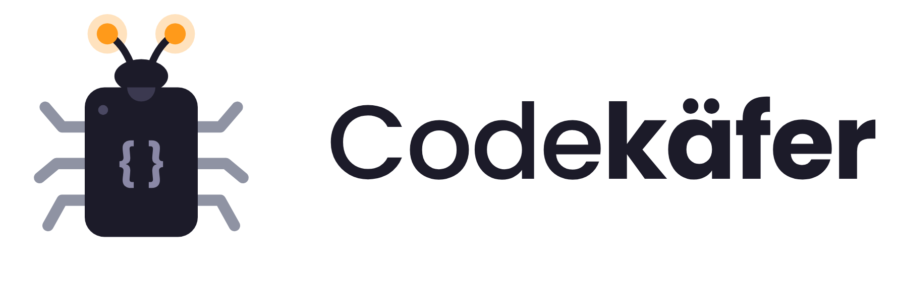

# Codekäfer

*Schaltungen bauen, programmieren, simulieren*

Blockbasierte Lernumgebung für Mikrocontroller im Technikunterricht – Schaltung aufbauen,
mit Blöcken programmieren, simulieren und auf das echte Board übertragen
(Arduino Uno, ESP32, ESP32-C5, ESP8266, Calliope mini, micro:bit), dazu der Codekäfer Schulserver
für Klassen, Unterricht und Prüfungen.

Dieses Verzeichnis enthält nur die **Programmpakete und Update-Informationen**:

- `update/Codekaefer.zip` – der Codekäfer (Windows)
- `update/Codekaefer-Schulserver.zip` – der Schulserver (Windows, Linux, Raspberry Pi)
- `update/version.json` – aktuelle Versionen (wird von den Programmen für Updates abgefragt)
- `update/nrf5/` – Paket für Calliope mini und micro:bit (beruht auf „Arduino-nRF5“ von Sandeep Mistry, LGPL 2.1;
  der vollständige Quelltext und die Änderungen stehen im Paket selbst)

© Ulrich Aichler. Der Codekäfer ist kostenlos, der Schulserver bis 1. Oktober 2027 – Bedingungen siehe [Nutzungsbedingungen](https://codekaefer.de/nutzungsbedingungen.html) und [Lizenzen.txt](Lizenzen.txt).
